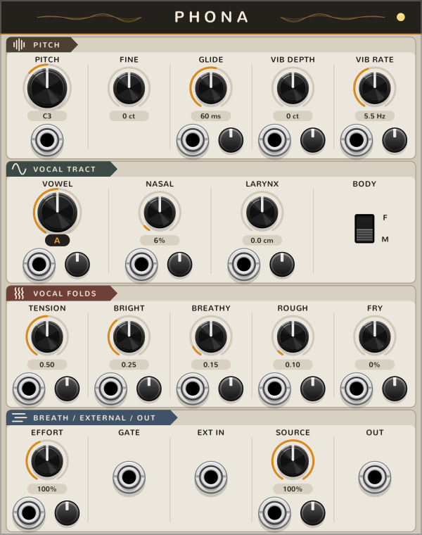
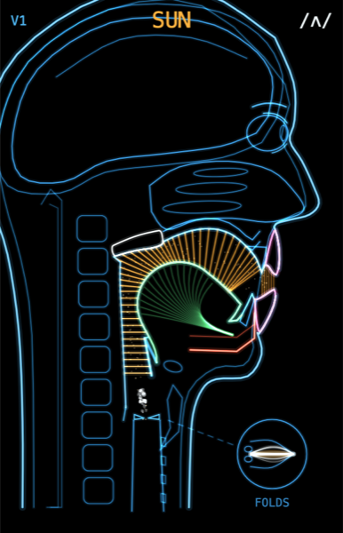
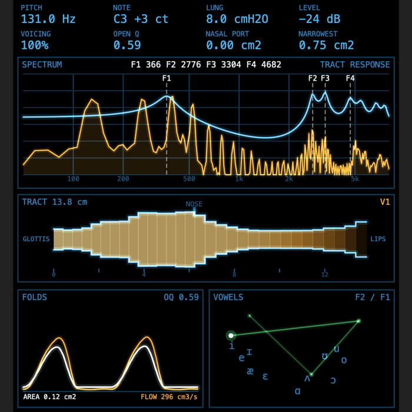

# Phona

A physical-model singing voice for VCV Rack 2. Phona simulates the vocal folds and the vocal tract
in real time. It sings vowels, sings words from text, and can filter an external sound through the
tract (talk box).

The voice is the [Chimera vocal synthesis engine](https://github.com/jamesondh/chimera-vocal-synth)
by Jameson Hodge (MIT). Phona puts the engine in a Rack module.

**Status: prototype.** It works, but it is not in the VCV Library. The only build is for Macs with Apple Silicon.

## Download and install

1. Download the newest `.vcvplugin` file from [Releases](https://github.com/millxing/Phona/releases).
2. Put it in `~/Library/Application Support/Rack2/plugins-mac-arm64/`.
3. Restart Rack.

Requirements: VCV Rack 2, macOS 11 or later, Apple Silicon. There is no Intel Mac, Windows or Linux build yet.
The build is signed with an Apple Developer ID and notarized by Apple.

## Modules

| Module | Width | What it does |
|---|---|---|
| **Phona** | 20 HP | The voice. |
| **Phona View** | 14 HP | Animated mouth and throat. |
| **Phona Scope** | 20 HP | Instrument display: spectrum, formants, tract, vocal folds, vowel chart. |
| **Phona Lab** | 16 HP | Tuning tool for the sung consonants. |



### Phona

- **Pitch:** PITCH, FINE, GLIDE, vibrato depth and rate. V/OCT input.
- **Vocal tract:** VOWEL, NASAL, LARYNX height, BODY (male or female).
- **Vocal folds:** TENSION, BRIGHT, BREATHY, ROUGH, FRY.
- **Breath:** EFFORT and GATE. With no cable in GATE, the voice sings all the time.
- **EXT IN and SOURCE:** send an external sound into the tract. SOURCE sets the mix between the folds and the external sound.
- Most knobs have a CV input with an attenuator.

**Lyrics.** Right-click the module and type text in the Lyrics field. Each gate sings the next
syllable: the consonants at the start, then the vowel while the gate is high, then the end of the
syllable when the gate closes. RESET goes back to the first syllable. A hyphen splits a word into
syllables. English only (CMU Pronouncing Dictionary).

**Polyphony.** Right-click > Polyphony (max voices): 1 to 4. Polyphonic V/OCT or GATE cables set how
many voices sound. OUT is polyphonic, with one channel for each voice. In lyrics mode, notes that
start together sing the same syllable.

**Beatbox (experimental).** Right-click > Lyrics/Beatbox. The text field then takes the symbols
`B` (kick), `Pf` (snare), `t` (closed hat) and `.` (rest). Each gate plays the next symbol. Beatbox mode is mono
and not finished.

### Phona View and Phona Scope

 

Put them next to Phona. They have no cables. You can put them on either side, and Phona Lab, View and
Scope can be in a chain in any order. The link light comes on when the module finds a Phona.

- **Phona View** shows a side view of the head: the tract shape, the air pressure in the tract,
  airflow, noise at the place where it starts, the nasal passage when it is open, and the vocal folds
  seen from above. The top line shows the voice, the syllable and the phoneme.
- **Phona Scope** shows:
  - pitch, note, lung pressure, level, voicing, open quotient, nasal port and the narrowest point of the tract
  - the output spectrum with the tract's frequency response and formants F1 to F4
  - the tract as a tube from the glottis to the lips
  - the glottal area and airflow
  - an F1/F2 vowel chart with average human vowels (Hillenbrand 1995) for the current body

  The formants come from a simple tube model of the tract shape. They are not measured from the engine's own filter.
- The selector at the bottom chooses the voice: **F** follows the newest note, **1 to 4** show that voice.
- Beatbox mode is not shown yet.

### Phona Lab

A tuning tool for the consonants in lyrics mode. Put it next to Phona, adjust the knobs, and copy the values.

## Build from source

The plugin is C++ for Rack and Rust for the engine. You need the Rack SDK 2.6.6, a Rust toolchain and `zstd`.

```sh
git clone https://github.com/millxing/Phona && cd Phona
git clone https://github.com/jamesondh/chimera-vocal-synth engine && git -C engine checkout 092b16ce
git -C engine apply ../rack-plugin/engine-fork.patch
# download Rack SDK 2.6.6 for your platform into sdk/Rack-SDK
cd rack-plugin
make install   # or: make share  (package without the build machine's user name, in share/)
```

Tests: `cd rack-plugin/rust && cargo test --release -- --test-threads=1`, and the scripts in
`rack-plugin/tests/` (`poly.sh`, `view.sh`).

More detail on the design and the measurements: [rack-plugin/HANDOFF.md](rack-plugin/HANDOFF.md).

## License

MIT. See [rack-plugin/LICENSE](rack-plugin/LICENSE). It includes the MIT notice of the Chimera engine.
The CMU Pronouncing Dictionary has its own license: [rack-plugin/LICENSE-CMUDICT.txt](rack-plugin/LICENSE-CMUDICT.txt).
